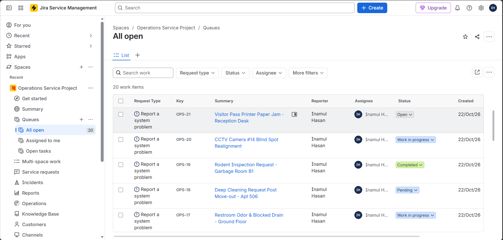

# 🏢 CAFM Helpdesk Operations & Ticketing Lifecycle Project

> **Domain:** Facilities Management (FM) | Computer-Aided Facility Management (CAFM)  
> **Platform:** Jira Service Management (Operations Service Project)  
> **Author:** Inamul Hasan  

---

## 📌 Project Overview
This project simulates a real-world **Facilities Management (FM) and Helpdesk Operations** workflow using **Jira Service Management**. It documents the end-to-end lifecycle of 20 master service requests spanning both **Hard Services** (building infrastructure and engineering maintenance) and **Soft Services** (facility support, cleaning, and security). 

The goal of this project is to showcase proficiency in **Service Desk Operations, Incident Tracking, SLA Management, Status Workflows, and Stakeholder Communication** tailored for the Dubai and UAE property and facilities management sector.

---

## 📸 System Screenshots & Workflow Proofs

### 1. Operations Queue & Dashboard View (20 Master Tickets)
Shows all 20 CAFM tickets categorized, assigned, and tracked across various operational statuses.

---

### 2. Work In Progress Tracking (Internal Tech Note)
Demonstrates internal coordination where a security technician note is logged while keeping the tenant updated.

---

### 3. Closed Ticket Resolution & Customer Reply
Highlights ticket closure verification with customer-visible resolution details and internal service log.

---

### 4. Data Exporting for Analytics
Exporting raw ticketing logs into Excel/CSV format for Power BI dashboard integration and KPI reporting.

---

## 🏗️ Scope & Ticket Distribution
A total of **20 Master Tickets** were created, managed, and tracked within Jira Service Management under the Operations Service Project (`OPS`).

* **Hard Services (10 Tickets):** HVAC cooling issues, main water pipe bursts, electrical DB tripping, elevator abnormal noise/jerking, fire safety false alarms, BMS chilled water pump failures, digital thermostats, low water pressure, ceiling plaster peeling, and access control barrier sensors.
* **Soft Services (10 Tickets):** Chemical spill emergency cleaning, pest control treatments, overflowing garbage chute blockages, garden irrigation leaks, tenant access keycards, restroom drainage blockages, move-out deep cleaning, rodent inspections, CCTV blind spot realignment, and reception printer maintenance.

---

## ⚙️ Ticket Lifecycle & Workflow Stages
Each ticket follows a strict operational lifecycle mirroring professional FM helpdesk protocols:
1. **Creation:** Raising tickets via Jira Service Desk portal (`Report a system problem` / `Emailed request`).
2. **Triage & Assignment:** Assigning incidents to helpdesk coordinators and technical teams (`Inamul Hasan`).
3. **Progress Tracking:** Updating statuses dynamically across **Open, Work in Progress, Pending, Resolved, and Completed**.
4. **Internal Notes & Customer Communication:** Adding technician dispatch logs (internal notes) and resolution updates (customer-visible replies).
5. **Closure & Exporting:** Verifying resolutions and exporting operational datasets for reporting and analytics.

---

## 📊 Dataset & Deliverables
* **`CAFM_Project_Report.csv`**: Raw transactional ticket export containing 20 work items, issue keys, summaries, assignee details, internal comments, customer replies, and status timestamps.
* **`CAFM_Project_Report.pdf`**: Comprehensive visual case study detailing every step of the ticketing lifecycle with UI screenshots from Jira.

---

## 🛠️ Key Technical Skills Demonstrated
* **Helpdesk & CAFM Operations:** Incident logging, categorization, dispatch coordination, and closure verification.
* **Jira Service Management:** Project configuration, queue filtering, status workflow transitions, and internal security notes.
* **Data Operations & Documentation:** Exporting operational datasets, structuring professional PDF project reports, and GitHub version control.

---

## 🚀 How to Use This Repository
1. Clone or download this repository.
2. Review the **`CAFM_Project_Report.pdf`** for a complete visual walkthrough of the Jira workflows.
3. Use the **`CAFM_Project_Report.csv`** dataset for building Executive Power BI Dashboards or conducting data analysis.
